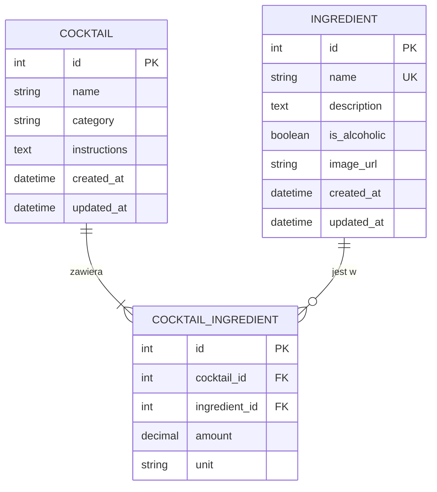

# Cocktails API

API do zarządzania koktajlami i składnikami. Zrobiłem je jako zadanie rekrutacyjne do KN Solvro (sekcja Backend).

Projekt jest napisany w Django i Django REST Framework, a bazą jest PostgreSQL odpalany w Dockerze.

Potrzebny jest Python 3.12 lub nowszy i Docker (praca powstała na Windows).
```bash
git clone https://github.com/Maxoo005/cocktails-api.git
cd cocktails-api
python -m venv .venv
.venv\Scripts\activate
pip install -r requirements.txt
copy .env.example .env
docker compose up -d
python manage.py migrate
python manage.py runserver
```

Po odpaleniu API jest pod http://127.0.0.1:8000/api/ i można je klikać bezpośrednio w przeglądarce. Panel admina jest pod http://127.0.0.1:8000/admin/, ale najpierw trzeba założyć konto przez `python manage.py createsuperuser`.

## Endpointy

| Metoda | Adres | Co robi |
| --- | --- | --- |
| GET | `/api/ingredients/` | lista składników |
| POST | `/api/ingredients/` | dodanie składnika |
| GET | `/api/ingredients/{id}/` | jeden składnik |
| PUT, PATCH | `/api/ingredients/{id}/` | edycja składnika |
| DELETE | `/api/ingredients/{id}/` | usunięcie składnika |
| GET | `/api/cocktails/` | lista koktajli razem ze składnikami |
| POST | `/api/cocktails/` | dodanie koktajlu razem ze składnikami |
| GET | `/api/cocktails/{id}/` | jeden koktajl |
| PUT, PATCH | `/api/cocktails/{id}/` | edycja koktajlu |
| DELETE | `/api/cocktails/{id}/` | usunięcie koktajlu |

## Paginacja

Listy są podzielone na strony, domyślnie po 10 wyników. Można to zmienić, np. `?page=2&page_size=20`. Maksymalnie jest 100 wyników na stronę.

## Filtry i sortowanie

Składniki:

- `is_alcoholic=true` albo `false`
- `search` szuka po nazwie

Koktajle:

- `category`: `cocktail`, `shot`, `long_drink`, `punch`, `other`
- `search` szuka po nazwie
- `ingredient` zwraca koktajle, które mają dany składnik
- `is_alcoholic=true` albo `false`. Koktajl jest alkoholowy, jeśli ma chociaż jeden alkoholowy składnik.
- `ordering`: `name`, `-name`, `created_at`, `-created_at`

Filtry można łączyć. Na przykład bezalkoholowe koktajle z miętą:

```
/api/cocktails/?is_alcoholic=false&ingredient=mięta
```

Jak poda się zły parametr, np. `?ordering=price` albo `?is_alcoholic=moze`, API zwraca błąd 400 z opisem, co jest nie tak.

## Dodawanie koktajlu

Koktajl dodaje się od razu ze składnikami i ich ilościami:

```json
{
  "name": "Mojito",
  "category": "long_drink",
  "instructions": "Rozgnieć miętę z limonką, dodaj lód i rum, dopełnij wodą gazowaną.",
  "ingredients": [
    {"ingredient_id": 2, "amount": "50", "unit": "ml"},
    {"ingredient_id": 3, "amount": "8", "unit": "piece"},
    {"ingredient_id": 1, "amount": "100", "unit": "ml"}
  ]
}
```

Dostępne jednostki to `ml`, `cl`, `oz`, `dash`, `tsp` i `piece`. Koktajl musi mieć co najmniej jeden składnik i ten sam składnik nie może się powtarzać.

## Baza danych



Koktajl i składnik łączy tabela `CocktailIngredient`. Zrobiłem to tak, bo ilość i jednostka zależą od konkretnego koktajlu, a nie od samego składnika. Mięta w Mojito może być w innej ilości niż w innym drinku.

## Kilka decyzji

- Koktajl razem ze składnikami zapisuje się w jednej transakcji. Jak coś się wywali, nie zostanie w bazie koktajl bez składników.
- Nie da się usunąć składnika, który jest w jakimś koktajlu. API zwraca wtedy 409.
- Ilości są zapisywane jako `Decimal`, a nie `float`, żeby nie było błędów z zaokrąglaniem.
- Na liście koktajli składniki są pobierane przez `prefetch_related`, żeby nie robić osobnego zapytania do bazy dla każdego koktajlu.

## Czego jeszcze nie ma

Z części "nice to have" nie zrobiłem (na ten moment):

- logowania, ról User i Admin i przypisania autora do koktajlu
- ocen i recenzji
- dokumentacji w Swaggerze
- testów automatycznych

